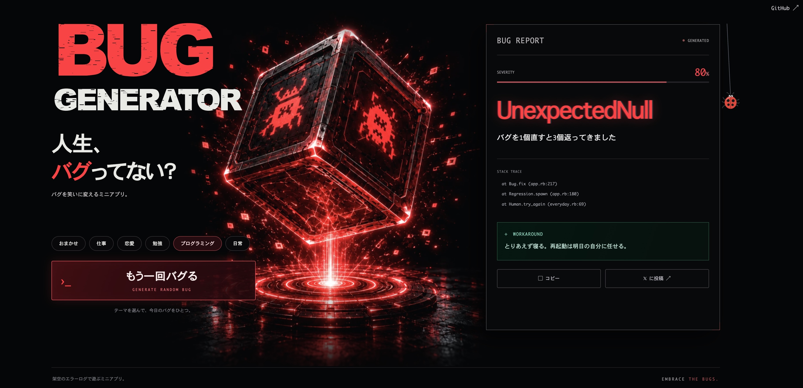

<div align="center">

# 🐞 Bug Generator

**人生、バグってない？**<br>
バグを笑いに変えるミニアプリ。

仕事・恋愛・勉強・プログラミング・日常の「あるある」を、架空のエラーログとして生成します。<br>
AIによる診断や実際のコード解析は行いません。

[**遊んでみる ↗**](https://bug-generator.onrender.com) · [GitHub](https://github.com/mize1978/bug_generator)


</div>

## 画面

黒×赤のキューブを主役にした画面と、正面向きの読みやすいレポート。右側には、つまんで揺らせるてんとう虫がぶら下がっています。

### 通常バグ



### レアバグ

通常生成の抽選確率は **1/12（約8.3%）**。レアを引くと「✦ RARE BUG」の印が付き、レポートの枠・エラー名・深刻度の数字とバーが金色に変わります。


※ 画像は2026年10月16日時点の公開画面です。

## 遊び方

1. 「おまかせ」、または5つのテーマから選びます。
2. 初回は「バグる」を押して生成。結果が出ると「もう一回バグる」に変わります。
3. エラー名・深刻度・スタックトレースと、ネタ寄りの **WORKAROUND** を楽しみます。
4. 気に入った結果はコピー、またはXに投稿できます。投稿用URLにはテーマとseedが入り、同じ生成ロジックの間は同じ結果を再現できます。

ボタンや入力欄などにフォーカスしていないときは、Space / Enterでも生成できます。

```text
UnexpectedNull
ローカルでしか動かない才能が開花しました

  at Local.run (app.rb:85)
  at Production.deploy (app.rb:20)
  at Human.try_again (everyday.rb:63)

WORKAROUND: 原因は昨日の自分。担当者は現在不在です。
```

## 現在の機能

- **テーマ選択**：仕事・恋愛・勉強・プログラミング・日常＋おまかせ
- **組み合わせ生成**：テーマ別のネタに、エラー種別・深刻度・スタックトレース・WORKAROUNDを組み合わせる
- **部分更新**：Turbo Frameで生成エリアと結果を差し替え
- **レア表示**：1/12の抽選と金色の表示
- **コピー / X投稿**：ログ全体のコピーと、結果を再現できるURLの共有
- **操作音**：Web Audio APIで生成・通常結果・レア結果・X投稿操作の音を合成。ブラウザの再生制限や端末設定によって鳴らない場合があります
- **触れるてんとう虫**：MizeLyのヒーローからSVGと動きを移植。ドラッグ、糸の揺れ、脚・触角の動き、カーソルを追う目線
- **レスポンシブ表示**：スマホでは「タイトル→小さめキューブ→テーマ→ボタン→レポート」の順に縦積み
- **動きを減らす設定への対応**：`prefers-reduced-motion`では、キューブの浮遊やてんとう虫のアニメーションを停止

メイン画面の操作は「生成・コピー・X投稿」に絞っています。履歴・お気に入り・画像保存・連続記録・日別レアへの導線は、現在の画面には置いていません。

## 構成とデザイン

| ファイル | 役割 |
| --- | --- |
| `app/services/bug_roll.rb` | テーマ別ネタ、seedによる再現可能な抽選、レア判定、コピー用ログ |
| `app/controllers/bugs_controller.rb` | テーマとseedの受け取り、初回の待機状態、共有URL |
| `app/views/bugs/index.html.erb` | 生成操作、レポート、WORKAROUND |
| `app/javascript/controllers/ladybug_controller.js` | てんとう虫の物理・脚・触角・目線の制御 |
| `app/javascript/controllers/copy_controller.js` | コピーと完了表示 |
| `app/javascript/application.js` | キーボード操作、効果音、ローディング表示 |
| `public/images/bug-cube-v2.webp` | AI生成したキューブの静止画素材 |
| `public/images/title-distress.svg` | 見出しの欠けを表現するマスク |

キューブは3Dモデルではなく静止画です。CSSの`transform`でゆっくり浮かせ、画像の端と床の反射はマスクで背景へ馴染ませています。光の影を毎フレーム変化させるアニメーションは使っていません。

レポートはキューブより手前に配置し、粒子が本文に重ならない構成にしています。赤いエラーの後に、緑のWORKAROUNDで冗談として着地します。

## 技術スタック

Ruby 3.2.3 / Rails 7.2 / Turbo / Stimulus / Importmap / Web Audio API / HTML・CSS / SQLite / Docker Compose / Render

Rubyの指定は`.ruby-version`と`Gemfile`、本番イメージの指定は`Dockerfile`を参照してください。開発用には`Dockerfile.dev`を用意しています。

## ローカル起動

DockerとDocker Composeを用意して、次を実行します。

```bash
git clone https://github.com/mize1978/bug_generator.git
cd bug_generator
docker compose up --build
```

[http://localhost:3000](http://localhost:3000)を開きます。Composeの起動コマンドはgemのインストール、`db:prepare`、Railsサーバーの起動を行います。

## テスト

```bash
docker compose run --rm web bin/rails test test/controllers/bugs_controller_test.rb test/services/bug_roll_test.rb
```

主な確認項目は、初回の待機状態、テーマ指定、seedによる結果の再現、入力値の不正時の処理、レアの表示、生成内容のバリエーションです。

---

**EMBRACE THE BUGS.**
